# SAGO — Segment Any Gaussians Online

Official code for **Online Segment 3D Gaussians via Launching Virtual Drones** (ECCV 2026), by Liwei Liao, Rongjie Wang, and Ronggang Wang.

[Paper](https://arxiv.org/abs/2607.01628) · [Web installation](SAGO_web/README.md) · [Desktop installation](SAGO_desktop/README.md) · [Releases](https://github.com/leviome/SAGO/releases)

SAGO turns 2D object prompts into 3D Gaussian selections, then refines them from multiple Virtual Drone viewpoints. This repository contains two complete applications. Each includes its own renderer and segmentation backend and can run independently of the other.

## Object gallery

<table>
  <tr>
    <td width="16.66%">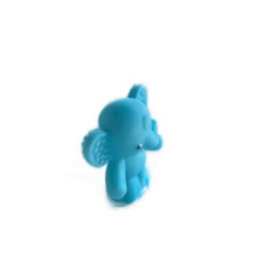</td>
    <td width="16.66%"></td>
    <td width="16.66%">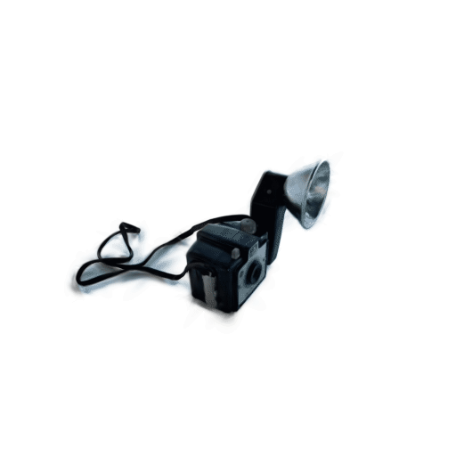</td>
    <td width="16.66%"></td>
    <td width="16.66%">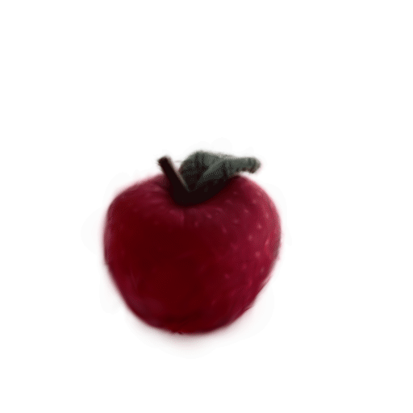</td>
    <td width="16.66%">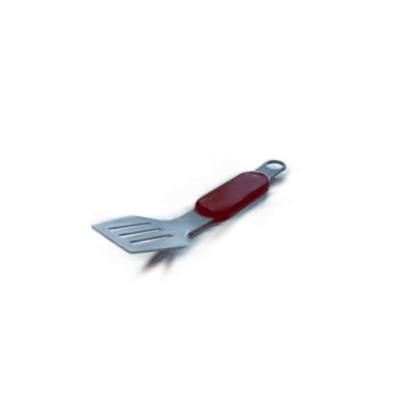</td>
  </tr>
  <tr>
    <td width="16.66%">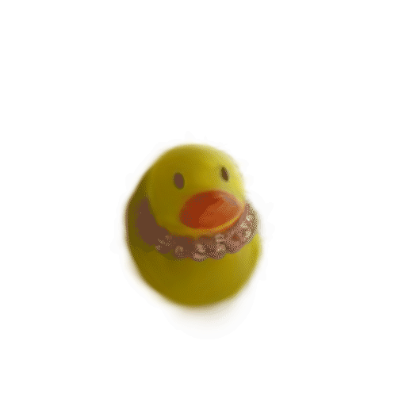</td>
    <td width="16.66%">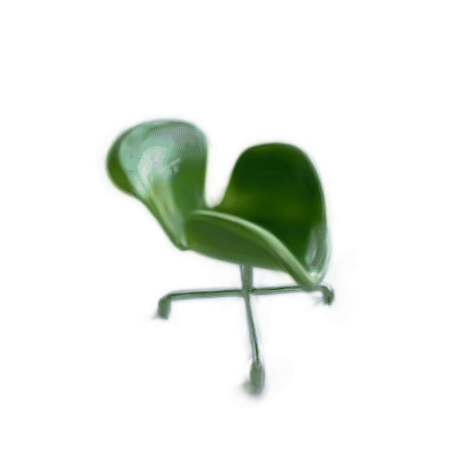</td>
    <td width="16.66%">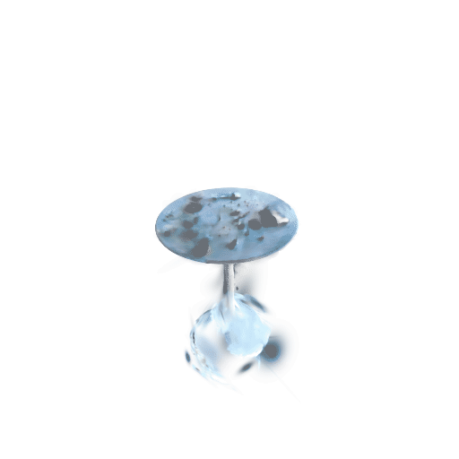</td>
    <td width="16.66%">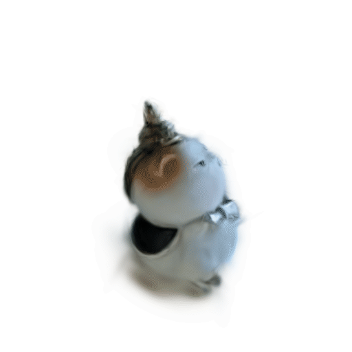</td>
    <td width="16.66%">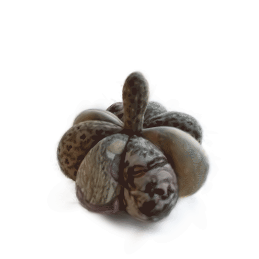</td>
    <td width="16.66%">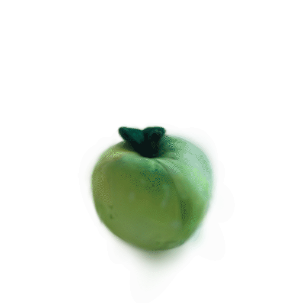</td>
  </tr>
  <tr>
    <td width="16.66%">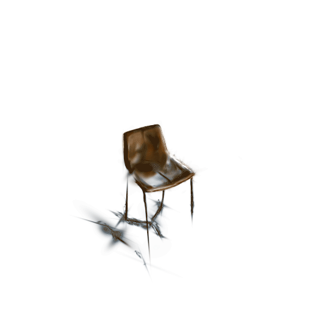</td>
    <td width="16.66%">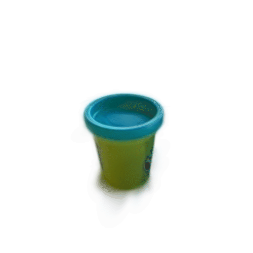</td>
    <td width="16.66%">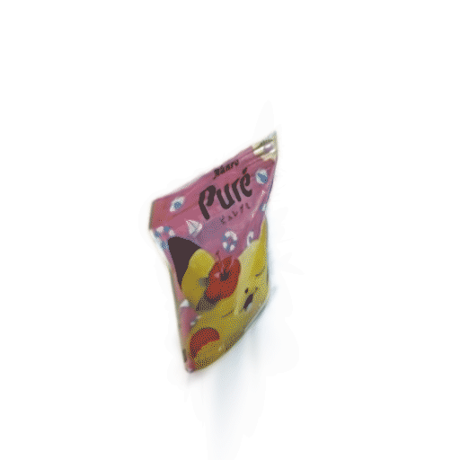</td>
    <td width="16.66%">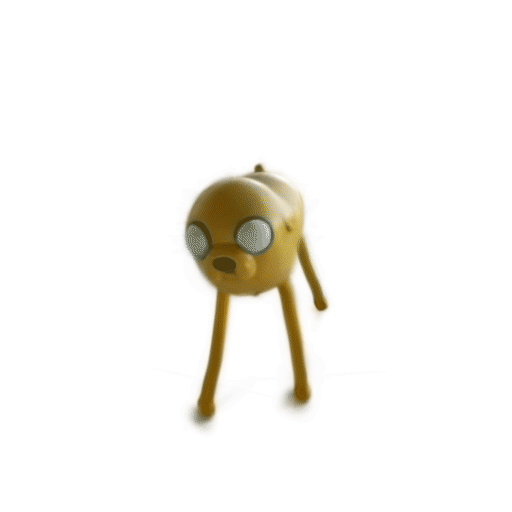</td>
    <td width="16.66%">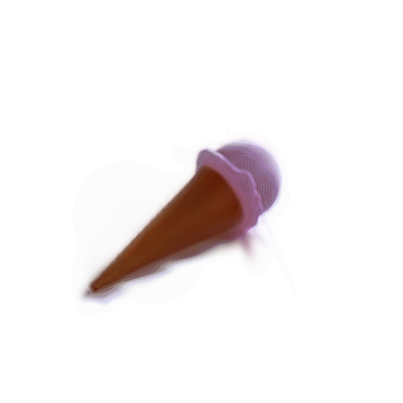</td>
    <td width="16.66%">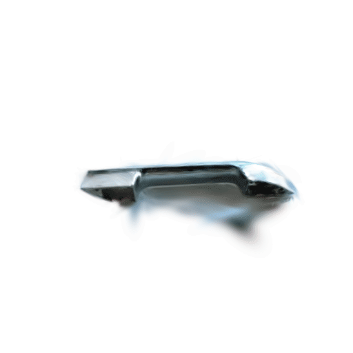</td>
  </tr>
  <tr>
    <td width="16.66%">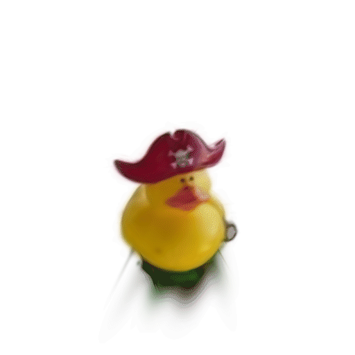</td>
    <td width="16.66%">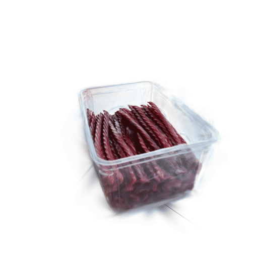</td>
    <td width="16.66%">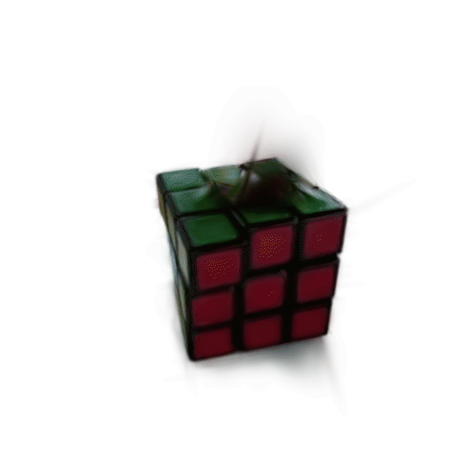</td>
    <td width="16.66%">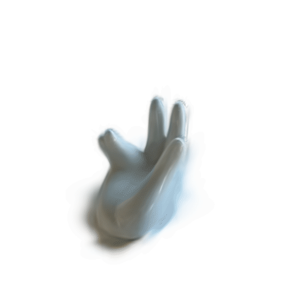</td>
    <td width="16.66%">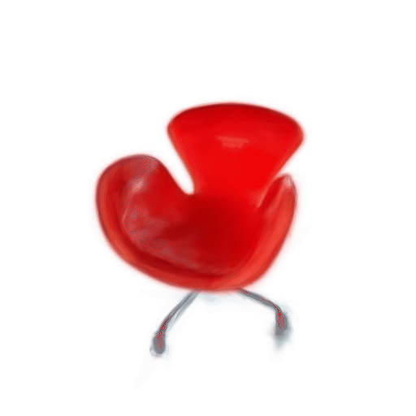</td>
    <td width="16.66%">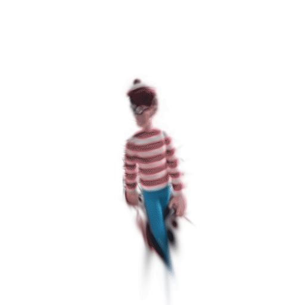</td>
  </tr>
</table>

## Applications

| | SAGO Web | SAGO Desktop |
|---|---|---|
| Source | [`SAGO_web/`](SAGO_web/) | [`SAGO_desktop/`](SAGO_desktop/) |
| Interface | Browser UI with a local Python/CUDA backend | Native PySide6 / Qt Widgets; no browser or HTTP server |
| Segmentation | SAM2; optional SAM3 / SAM3.1 | SAM2 only |
| Prompts | Foreground/background points and boxes; optional text prompts | Foreground/background points and boxes |
| Platform | Linux NVIDIA/CUDA backend | Linux x86-64, NVIDIA/CUDA |
| Start | `python run.py` inside `SAGO_web/` | `./sago scene.ply` inside `SAGO_desktop/`, or install the Debian package |

Both interfaces default to English and support Chinese. The current Desktop release does not support macOS / Apple Silicon.

## Get the code

```bash
git clone https://github.com/leviome/SAGO.git
cd SAGO
```

Then follow the complete environment instructions for your application:

- **[SAGO Web](SAGO_web/README.md#environment-installation):** install a compatible CUDA-enabled PyTorch environment, build the included rasterizers, obtain the model checkpoint, and launch the local web interface.
- **[SAGO Desktop](SAGO_desktop/README.md):** install the Linux Debian package from [Releases](https://github.com/leviome/SAGO/releases), or prepare a CUDA Python environment and run the native application from source.

An NVIDIA GPU, compatible drivers, and a CUDA/PyTorch runtime are required for both backends. A matching CUDA toolkit and C++ compiler are needed to build the bundled extensions. Installing the Desktop package does not install NVIDIA drivers or PyTorch.

## Repository layout

```text
SAGO/
├── assets/         # Animated object gallery
├── SAGO_web/       # Independent browser application and Python/CUDA backend
├── SAGO_desktop/   # Independent native Linux application and Python/CUDA backend
├── CITATION.cff
├── THIRD_PARTY_NOTICES.md
└── README.md
```

Run application commands from the corresponding application directory. The two backends are intentionally self-contained; neither imports code from its sibling directory.

## Main features

- Automatic 2D mask updates after point or box prompts, followed by six-view 3D refinement.
- Multiple object IDs, editable names, merging, renumbering, foreground coloring, and scene-local persistence.
- Ground calibration from three points and upright bounding boxes.
- Visible-Gaussian correction with preview and confirmation.
- RGB, Splats, Points, and Depth rendering, plus Virtual Drone trajectories and camera frustums.
- Foreground PLY/mask exports and single-orbit GIFs for the current selection or all saved objects.

Desktop additionally provides automatic high-DPI rendering and **C** to cancel the current segmentation round. See each application's README for supported shortcuts and detailed behavior.

## Models and releases

Model checkpoints, scenes, virtual environments, caches, generated outputs (apart from the curated gallery in `assets/`), and Debian packages are **not stored in Git**. Download model weights from the upstream projects as described in each application's model guide:

- [Web model setup](SAGO_web/models/README.md)
- [Desktop SAM2 setup](SAGO_desktop/models/README.md)

Installers are published as GitHub Release assets. Release tags use application prefixes, such as `web-v2.0` and `desktop-v1.1.2`, so Web and Desktop can be versioned independently. The full Desktop installer includes SAM2 weights and Qt; source archives do not.

The former standalone Web repository has been consolidated here. Its commit history is retained in this repository; the previous v2.0 snapshot is available under `legacy-web-v2.0`. Earlier commits remain accessible through the retained history. New development and releases belong to `leviome/SAGO`.

## Citation and licenses

If you use SAGO in your research, please cite [the paper](https://arxiv.org/abs/2607.01628); machine-readable metadata is in [CITATION.cff](CITATION.cff).

License files and third-party notices are preserved in both application directories. See [THIRD_PARTY_NOTICES.md](THIRD_PARTY_NOTICES.md) before redistributing code, model weights, or installers; vendored components retain their own licenses.
